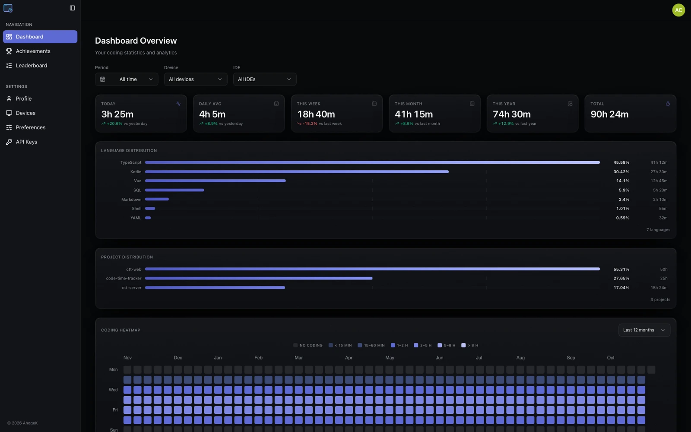
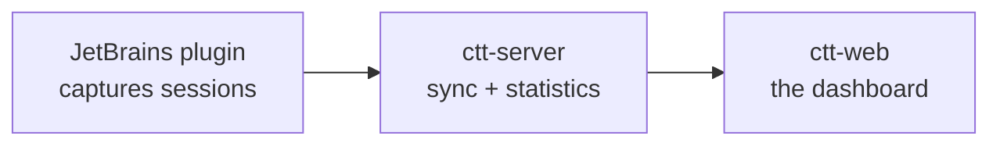

<h1 align="center">ctt-web</h1>

<p align="center">
  <strong>Know where your coding time actually goes.</strong><br>
  A self-hostable analytics dashboard for Code Time Tracker.
</p>

<p align="center">
  <a href="#quick-start"><strong>Quick start</strong></a> ·
  <a href="docs/architecture.md">Architecture</a> ·
  <a href="https://github.com/AhogeK/ctt-server">Server</a> ·
  <a href="https://github.com/AhogeK/code-time-tracker">Plugin</a>
</p>

<p align="center">
  <a href="LICENSE"></a>
  
  
  
  
</p>

<p align="center">
  <a href="docs/assets/readme/dashboard.webp">
    
  </a>
</p>

<p align="center"><sub>Dashboard with sample data. Light and dark themes are available.</sub></p>

ctt-web is the frontend of the Code Time Tracker ecosystem. The
[JetBrains plugin](https://github.com/AhogeK/code-time-tracker) captures your coding sessions,
[ctt-server](https://github.com/AhogeK/ctt-server) stores and aggregates them, and this dashboard
turns them into a view you can read in seconds.

Everything is open source and free to self-host.

## What you get

| **The dashboard** | **The workspace** |
| :--- | :--- |
| **See your time** — summary cards, daily and long-term trends, heatmaps, language/project/IDE distributions, time-of-day views, and recent sessions. | **Filter with context** — inspect a date range, one device, or one IDE; the active view stays in the URL. |
| **Spot patterns** — compare periods, follow your streak, and see when and where your best work happens. | **Manage devices and keys** — check last activity and last-used IDE, revoke devices, and create scoped API keys with optional expiry. |
| **Keep momentum** — browse achievement ladders and compare on the multi-dimension leaderboard. | **Sign in securely** — email/password or GitHub OAuth, password reset, email verification, and profile controls. |
| **Make it yours** — English and 简体中文, with light, dark, and system themes, and a reduced-motion option. | **Own your data** — run the whole stack yourself; no paid tiers or feature locks. |

## How it fits together



The server is the source of truth for sync and statistics. This repository contains the web UI only.

## Quick start

### Requirements

- **Node.js** `^20.19.0 || >=22.12.0`
- **pnpm** `12.11.2` (pinned in `packageManager`)

### Run locally

```sh
git clone https://github.com/AhogeK/ctt-web.git
cd ctt-web
pnpm install
pnpm dev
```

The app expects a running ctt-server. The Vite dev server proxies `/api` to
`http://localhost:8080/ctt-server`; start the server first, or point the app at another API origin.

| Variable | Default | Purpose |
| --- | --- | --- |
| `VITE_API_BASE_URL` | `/api` | API base URL used by the browser client |

```sh
# .env
VITE_API_BASE_URL=/api
```

### Production build

```sh
pnpm build
pnpm preview
```

`pnpm build` runs the type checker and the production build. Deploy the generated `dist/` directory
behind the same origin (or the configured API base) as ctt-server.

## Development

| Command | What it does |
| --- | --- |
| `pnpm dev` | Start the Vite development server |
| `pnpm build` | Type-check and create a production build |
| `pnpm preview` | Preview the production build locally |
| `pnpm test:unit` | Run Vitest unit tests |
| `pnpm test:e2e` | Run Playwright end-to-end tests (builds the production bundle first) |
| `pnpm type-check` | Run `vue-tsc` only |
| `pnpm lint` | Run the configured lint passes |
| `pnpm format` | Format source files |
| `pnpm check:i18n` | Check locale coverage and hard-coded strings |

For Playwright on a fresh machine, install its Chromium engine once:

```sh
pnpm exec playwright install chromium
```

VS Code with the **Vue - Official** extension is recommended; disable Vetur if it is installed.

## Tech stack

| Layer | Technology |
| --- | --- |
| Framework | Vue 3 + TypeScript |
| Build | Vite+ (Vite 8 toolchain) |
| Routing | Vue Router |
| Server state | TanStack Query |
| App state | Pinia |
| UI | Tailwind CSS 4 + Reka UI + shadcn-vue |
| Charts | Apache ECharts |
| Forms | Vee-Validate + Zod |
| i18n | Vue I18n |
| Tests | Vitest + Playwright |
| Package manager | pnpm 12 |

## Project structure

```text
src/
├── features/     feature modules: dashboard, devices, settings, auth, landing, leaderboard, achievements
├── layouts/      app, auth and marketing shells
├── components/   shared app components and UI primitives
├── lib/          API clients, schemas and utilities
├── stores/       Pinia stores
└── router/       route modules and guards
```

More detail is available in [docs/architecture.md](docs/architecture.md) and
[docs/dev-handbook.md](docs/dev-handbook.md).

## Testing

- Unit tests use Vitest and Testing Library.
- End-to-end tests use Playwright against the real router with mocked API routes; no live backend is
  required for the E2E suite.
- The suite runs against a production build, so a local run matches CI.
- The E2E suite runs on Chromium only. Install the browser with the command above before the first run.

## Related projects

- [ctt-server](https://github.com/AhogeK/ctt-server) — Spring Boot API, sync engine, and leaderboard
- [code-time-tracker](https://github.com/AhogeK/code-time-tracker) — JetBrains IDE plugin
- [ctt-web](https://github.com/AhogeK/ctt-web) — this dashboard

## Contributing

Issues and pull requests are welcome. Keep changes focused, explain the user-facing effect, and add
or update tests when behavior changes. For larger changes, open an issue first so the approach can
be discussed.

<div align="center">

<h2>💖 Support</h2>

<p><strong>Free and open source. No paid tiers.</strong></p>

<p>If ctt-web helps you see where your time goes, you can support its development:</p>

<p>
<a href="https://ko-fi.com/ahogek"></a>
&nbsp;
<a href="https://afdian.com/a/AhogeK"></a>
&nbsp;
<a href="https://solscan.io/account/55XnqvGKwH6LamJB7tSwUbrmJikEU2zwP3k1FjsdyEys"></a>
</p>

<p><sub>Donations are optional and carry no rewards or privileges.</sub></p>

<p>Made with ❤️ for developers who care where their time goes.</p>

</div>

<div align="center">

<h2>License</h2>

<p><a href="LICENSE">MIT</a></p>

</div>
